# Website redesign, round 3: minimal, over the hiker-on-the-ridge photo

Your brief: *"try creating tasteful website designs using this image as the background. should be minimal style/words."*

There are three takes and a refined final. **Recommended: `redesign3/final`**, which is the "sky" take after a critique pass. Nothing was pushed, `main` is untouched, nothing was deployed, and every branch builds.

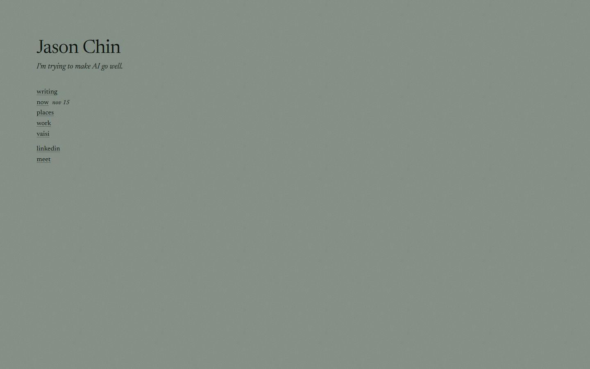

## How to run

```powershell
cd ".worktrees\r3-final"; npm run dev
```

The takes also have worktrees: `.worktrees\r3-sky`, `r3-edge` and `r3-margin`. Or check out a branch in the main folder:

```powershell
git checkout redesign3/final; npm install; npm run dev
```

## The photo
Your reference (`redesign-refs/bg-hiker-ridge.jpg`, 646×431) turned out to be a **mirrored, teal-graded crop of your NOLS film scan** `NOLS_I_THINK_I_CAN.JPG` (2620×1738). No higher-resolution copy of that exact framing exists, so I learned its colour grade and applied it to wider crops of the full-res original:
- a 1310×873 desktop crop, twice the pixels
- a 760×1140 portrait crop for phones

The mood, the single small hiker and the ridge rising left-to-right are all kept, and the hiker stays crisp. The assets are in `public/bg3/`, with `public/bg3/README.md`. `scripts/make-hiker-bg.py` documents the grade. Your originals are untouched.

| Your reference | What the site uses (wider, regraded) |
|---|---|
| 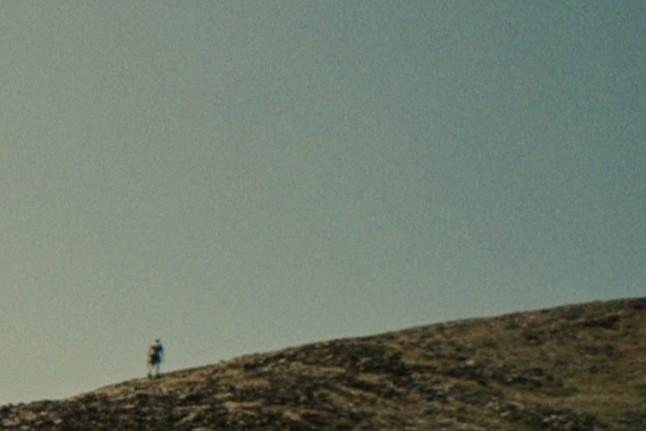 |  |

## The final (`redesign3/final` @ 3fee75c)
**Home.** Your name, one line, and plain lowercase links (writing · now · places · work · vaisi · linkedin · meet) sit top-left in the sky. The hiker and ridge stay uncovered. One screen, no scroll, at every size.
- **Phones:** the caption sits lower, just above the ridge, so the text clears 4.5:1 contrast without a visible veil.
- **Photo:** a still film-grain overlay, plus a flat sky colour while the photo loads, so there's no grey flash.

**Inner pages.** The photo stays full-screen behind every page (you asked for this after the first look). A calm, opaque reading sheet scrolls over it: 19px text on a ~65-character measure. On wide screens the sheet sits under your name on the left, so the hiker stays in view on the right. The intro and Jason-ing open the writing page. Debate and Eagle Scout are on work, and the framed, drifting globe is on places.

**Contrast.** Measured against the actual photo pixels at the worst pixel: 4.52–4.71:1 on the home and 4.66–5.65:1 on the band, across 390, 768, 1440 and 1920 widths. The reading sheet is 6.5:1 or better.

| Phone home | Writing (phone, before the full-screen fix) | Post (before the full-screen fix) |
|---|---|---|
| 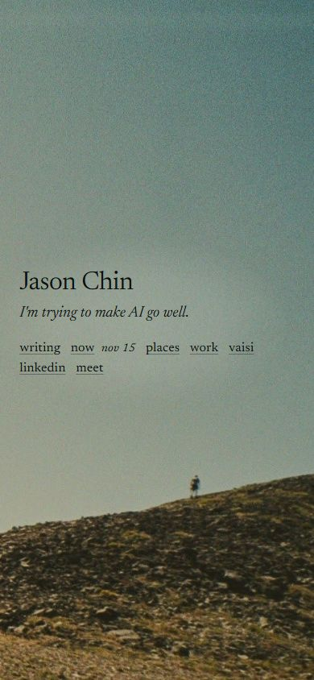 | 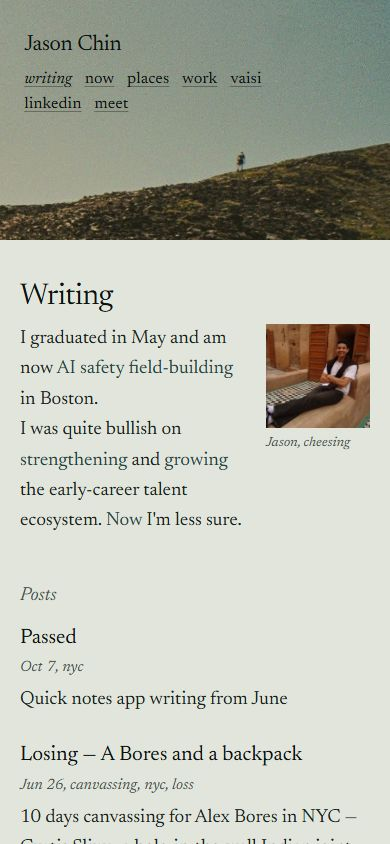 | 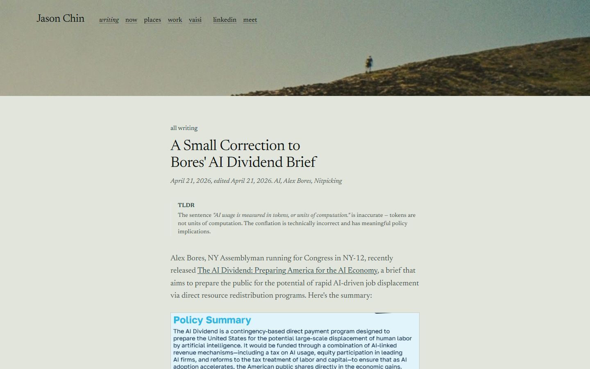 |

| Places | Work | Writing |
|---|---|---|
| 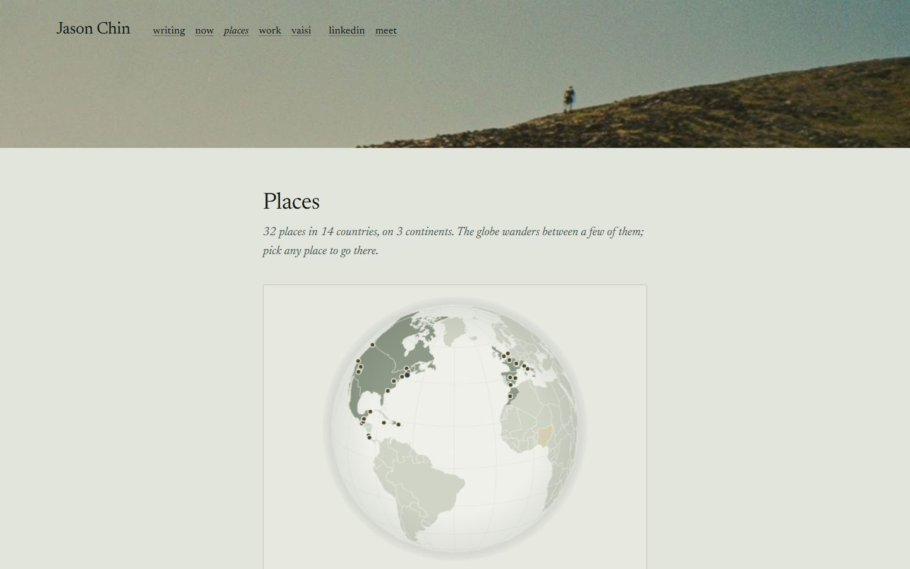 | 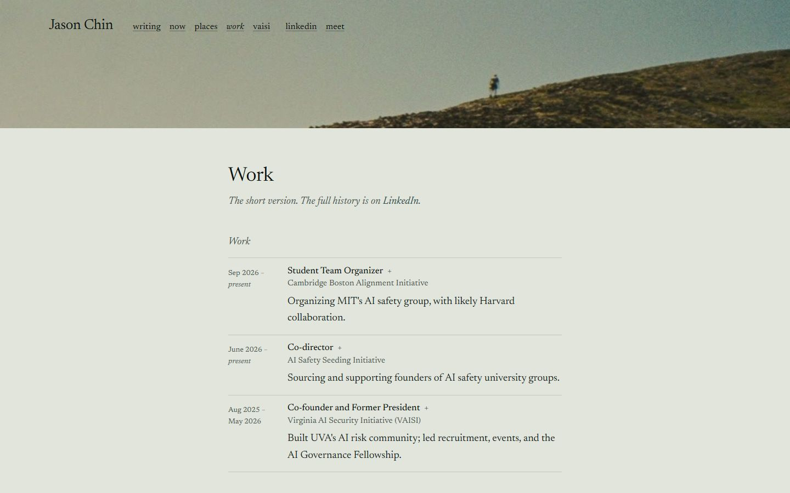 | 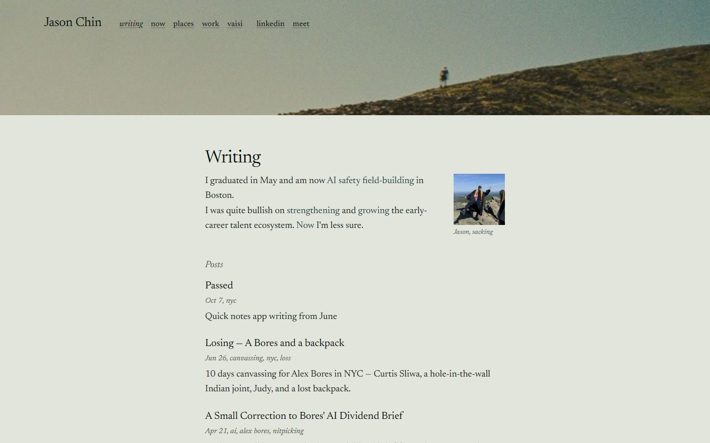 |

## The three takes (critic's scores)

| Take | Idea | Score | Branch |
|---|---|---|---|
| **sky** → final | text top-left in the sky, tiny lowercase links | 7.5 | `redesign3/sky` @ 2dc4821 |
| edge | centred serif name and hairline, small-caps links along the bottom edge | 7 | `redesign3/edge` @ 0b4d9ae |
| margin | a pale haze left column, with the photo filling the rest | 6 | `redesign3/margin` @ bb969d2 |

| sky | edge | margin |
|---|---|---|
| 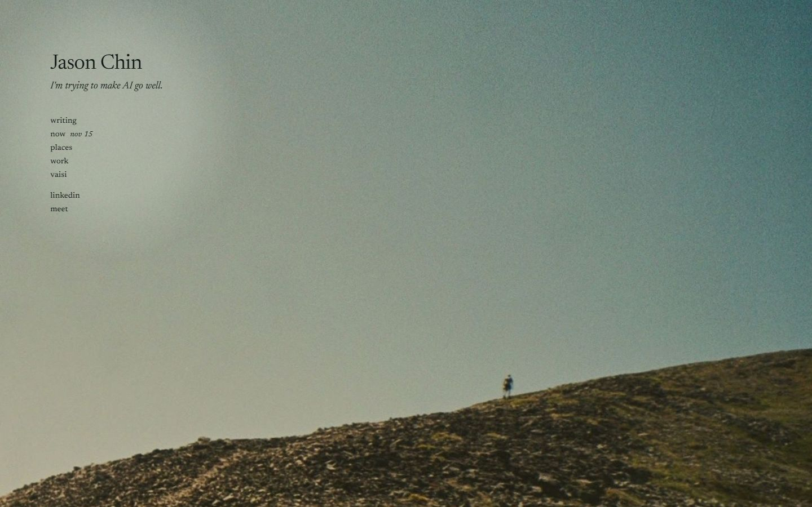 | 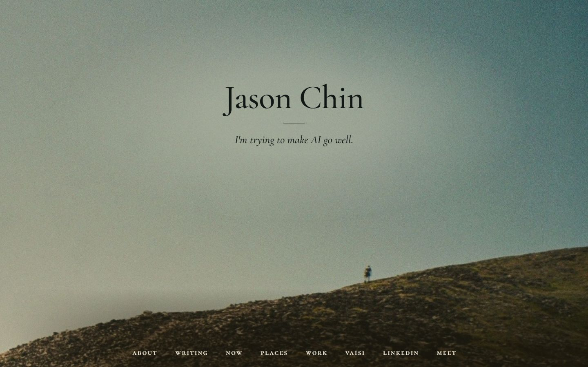 | 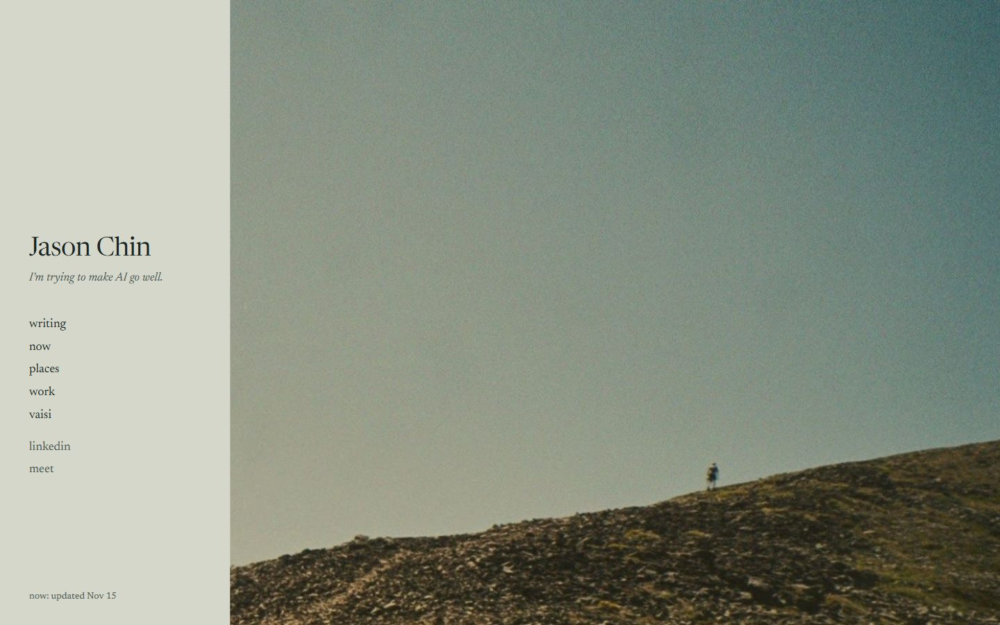 |
| 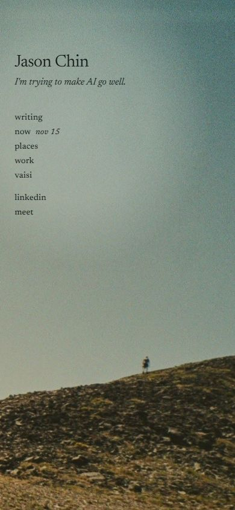 | 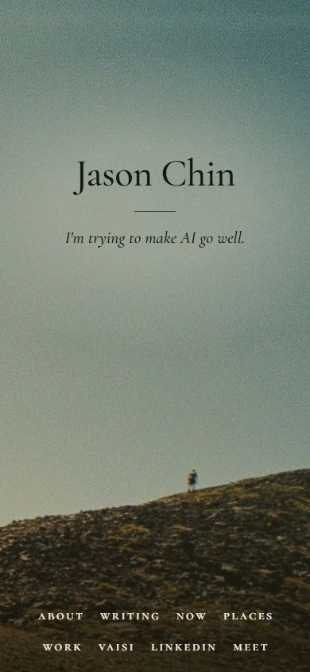 | 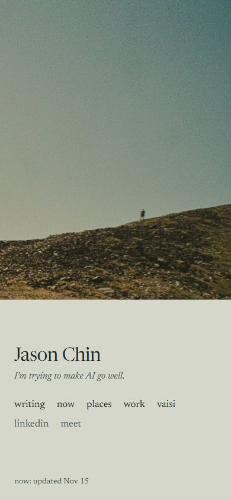 |

**What the final took from each:** sky's restraint on the home; edge's photo-band inner pages and reading rhythm; margin's opaque reading surface. The critique's main fixes:
- drop the haze "blotch" behind the text
- bigger name and links
- a clean phone nav wrap
- a loading colour
- calmer photos inside posts
- still grain

Each branch's `DECISIONS.md` has the details.

## Open questions for you
1. **Name size** on the home: is it right now, or should it be bigger or smaller?
2. **Phone home:** caption low (just above the ridge, as now) or near the top?
3. **"about" link:** should the intro get its own link, as edge does, or stay at the top of writing?
4. **Grain:** still (as now) or a gentle shimmer?

## Notes
- **Screenshots:** headless-Chrome captures of the production builds. Fades are switched off for the capture only, because headless virtual time doesn't advance CSS fades. In the current version there is no fade: the photo paints as soon as it loads, over a matching flat sky colour.
- **Untouched:** `.worktrees/r2-ridge` (another session's uncommitted work) and your dev servers on 5192/5194.
- **Rounds 1 and 2** are documented in `REDESIGN_README.md` on `redesign/final` and `REDESIGN2_README.md` on `redesign2/final-hearth`/`final-trail`.
